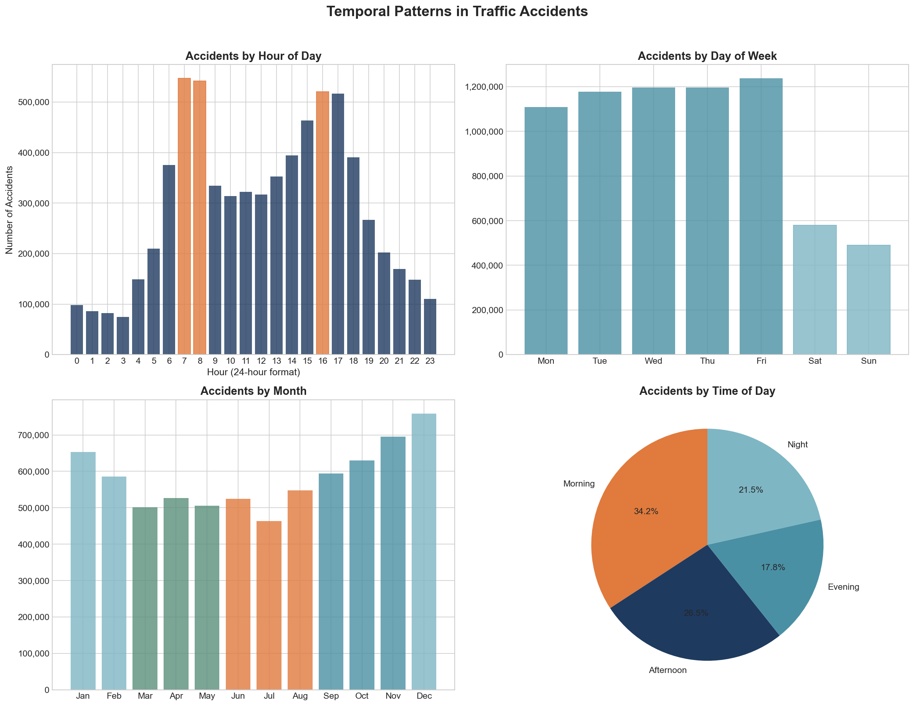
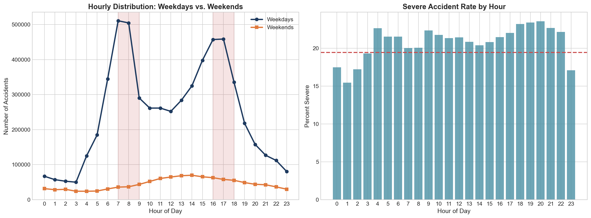
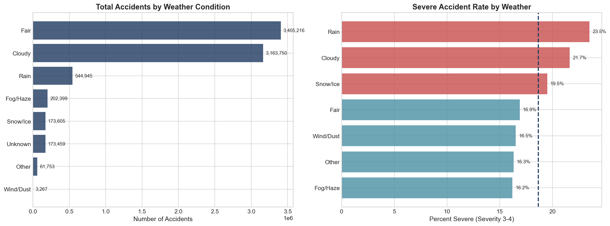
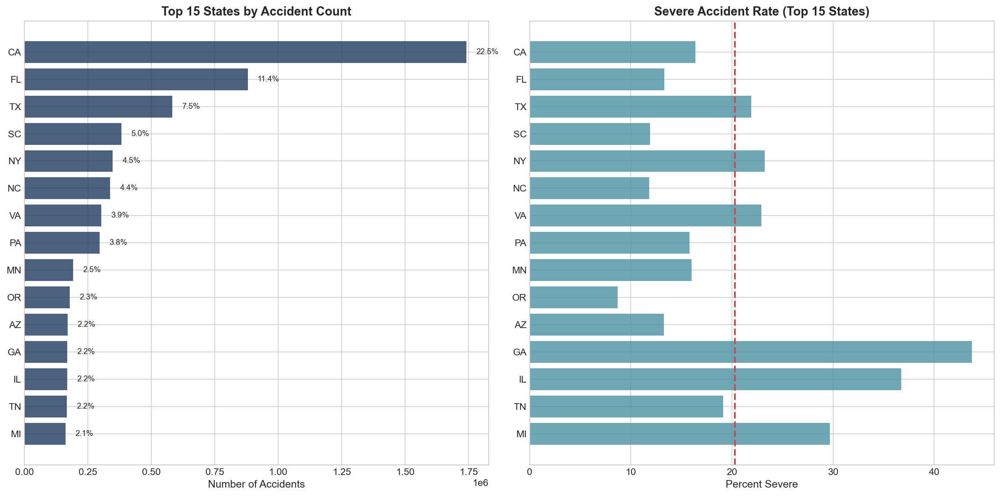
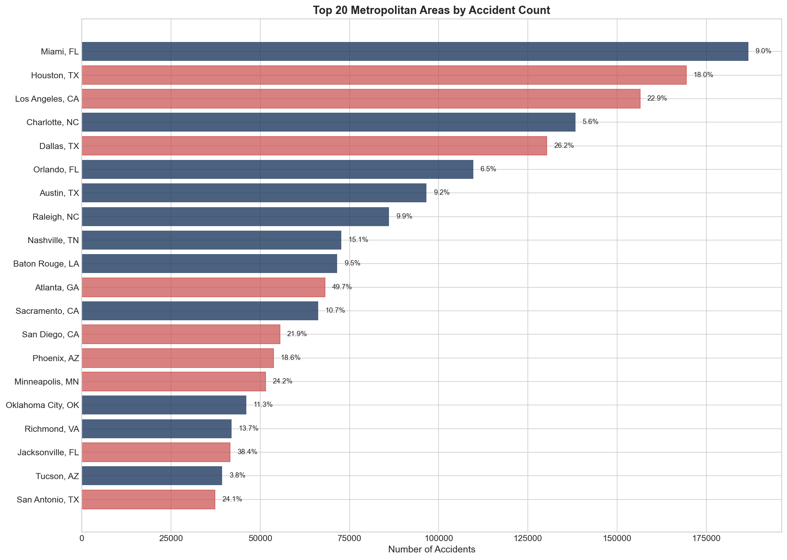

# US Traffic Accident Analysis

## Data-Driven Insights for Road Safety | Department of Transportation


### Quick Links

| Resource | Link |
| :--- | :--- |
| **Interactive Presentation** | <a href="https://jabuelouf.github.io/us_traffic_cap/" target="_blank">View Presentation</a> |
| **Tableau Dashboard** | <a href="https://public.tableau.com/app/profile/jonathan8167/viz/US_Traffic_Cap/USTrafficAccidentAnalysis" target="_blank">View on Tableau Public</a> |
| **Run Analysis in Colab** | <a href="https://colab.research.google.com/github/Jabuelouf/us_traffic_cap/blob/main/US_Traffic_Accident_Analysis.ipynb" target="_blank"></a> |

---

## Executive Summary

Analysis of **7.7 million US traffic accidents** (2016-2023) reveals three actionable patterns for resource allocation and road safety intervention:

| Finding | Key Statistic | Actionable Recommendation |
| :--- | :--- | :--- |
| **Temporal Clustering** | Rush hours account for 33.5% of accidents | Time-targeted patrol and incident response (7-9 AM, 3-6 PM) |
| **Weather Impact** | Rain shows 23.5% severe disruption rate vs 16.9% fair | Weather-responsive dynamic warning and speed advisories |
| **Geographic Hotspots** | Top 5 states represent 50.9% of all accidents | Corridor-targeted infrastructure safety investments |

---

## Project Overview

The Department of Transportation (DOT) requires data-driven guidance to optimize safety enforcement and infrastructure planning. This analysis investigates 7.7M accident records across the contiguous United States to determine:
1. **When** incidents cluster across hours, weekdays, and seasonal commute windows.
2. **What conditions** amplify accident severity and traffic disruption duration.
3. **Where** safety interventions yield the highest return on operational investment.

---

## Key Findings

### 1. Temporal Patterns and Commute Windows
- **Peak Commute Concentration:** Rush hours (7-9 AM and 3-6 PM across all days) account for **33.5% of all accidents** (2,588,624 incidents).
- **Peak Incident Day:** Friday records the highest accident volume of any weekday.
- **Seasonal Surge:** December represents the highest single accident month with 758,783 reported incidents (9.8% of total volume).





### 2. Weather Conditions and Severity Impact
While fair and cloudy conditions account for 85% of total baseline volume, adverse weather disproportionately elevates accident severity (measured by duration of traffic disruption):

| Weather Condition | Severe Disruption Rate (%) | Relative Risk Factor |
| :--- | :---: | :---: |
| **Rain** | **23.5%** | 1.39x vs Fair |
| **Cloudy** | 21.7% | 1.28x vs Fair |
| **Snow / Ice** | 19.5% | 1.15x vs Fair |
| **Fair (Baseline)** | 16.9% | 1.00x (Baseline) |

Adverse weather conditions overall produce a **1.252x higher relative risk** of severe road disruption compared to baseline fair conditions (21.16% adverse average vs 16.91% fair).



### 3. Geographic Concentration and Metropolitan Hotspots
Accidents are heavily concentrated in high-density transit corridors:
- **Top 5 States:** California (22.5%), Florida (11.4%), Texas (7.5%), South Carolina (5.0%), and New York (4.5%) account for **50.9% of all accidents** (3,934,979 incidents).
- **Top 3 Metropolitan Hotspots:** Miami (186,768), Houston (169,428), and Los Angeles (156,491) together account for 512,687 incidents.





---

## Recommendations

### 1. Time-Based Patrol and Incident Response
Focus active patrol deployments and emergency clear crews during peak morning (7-9 AM) and evening (3-6 PM) corridors to reduce secondary incident risk.
- **Target:** Weekday commute hours.
- **Metric:** Mean clearance time and incident recurrence rate.

### 2. Automated Weather-Responsive Advisory Systems
Deploy automated variable speed limits and advance message signs triggered by real-time precipitation sensors.
- **Target:** Rain and icy transit bottlenecks.
- **Metric:** Severe disruption rate during adverse weather events.

### 3. High-Density Corridor Infrastructure Prioritization
Target highway safety improvements, barrier upgrades, and sensor coverage on identified arterial corridors across California, Florida, and Texas.
- **Target:** Top 10 metropolitan accident zones.
- **Metric:** Year-over-year corridor accident count reduction.

---

## Methodology

This project follows the **CRISP-DM** (Cross-Industry Standard Process for Data Mining) framework:
1. **Business Understanding:** Translating DOT road safety mandates into empirical analytical objectives.
2. **Data Understanding:** Ingestion and validation of 7,728,394 accident records across 49 US states.
3. **Data Preparation:** Feature engineering, missing value imputation, timestamp normalization, and categorical bucketing.
4. **Statistical Analysis:** Chi-square tests of independence, Cramer's V effect size calculations, and Relative Risk metrics.
5. **Evaluation:** Verification of findings against statistical significance thresholds and domain logic.
6. **Deployment:** Interactive Tableau dashboard, reproducible Google Colab notebook, and web presentation.

---

## Data Source

**US Accidents Dataset (2016 - 2023)**
- **Total Records:** 7,728,394 accidents
- **Geographic Coverage:** 49 US states
- **Timeframe:** February 2016 through March 2023
- **Primary Source:** [Kaggle US Accidents Dataset](https://www.kaggle.com/datasets/sobhanmoosavi/us-accidents) by Sobhan Moosavi

---

## Local Setup & Quickstart

### Prerequisites
- Python 3.10+
- Jupyter Notebook or JupyterLab

```bash
git clone https://github.com/Jabuelouf/us_traffic_cap.git
cd us_traffic_cap

# Create and activate virtual environment
python -m venv .venv
source .venv/bin/activate  # On Windows: .\.venv\Scripts\Activate.ps1

# Install dependencies
pip install -r requirements.txt

# Optional: Download the 7.7M-row source dataset via Kaggle CLI
kaggle datasets download -d sobhanmoosavi/us-accidents -p data/ --unzip

# Launch the analysis notebook
jupyter notebook US_Traffic_Accident_Analysis.ipynb
```

Alternatively, run directly in your browser with zero local setup:
[](https://colab.research.google.com/github/Jabuelouf/us_traffic_cap/blob/main/US_Traffic_Accident_Analysis.ipynb)

---

## Tech Stack

- **Data Processing & Analysis:** Python, Pandas, NumPy, SciPy
- **Statistical Visualization:** Matplotlib, Seaborn
- **Interactive Dashboard:** Tableau Public
- **Environment Management:** Conda / Pip / Jupyter

---

## Author

**Jonathan Abuelouf**
Portfolio: [www.jabuelouf.me](https://www.jabuelouf.me)

---

## License

The original code, analysis, and project documentation in this repository are licensed under the MIT License. See [LICENSE](LICENSE) for details.

**Data Attribution:** This project uses the [US Accidents dataset](https://www.kaggle.com/datasets/sobhanmoosavi/us-accidents) by Sobhan Moosavi. The dataset is not included in this repository and remains subject to its original licensing and usage terms.
